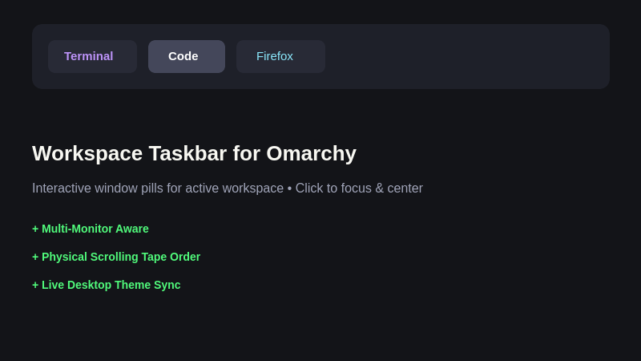

# Workspace Taskbar

An [Omarchy](https://omarchy.org) bar widget that displays interactive window pills for the active workspace.

Click any pill to immediately focus that window. On scrolling-layout workspaces, clicking also centers the window's column in your viewport.



---

## Features

- **Active Workspace Window Pills**: Shows open applications on the currently active workspace for the screen the bar is on. Multi-monitor setups track each screen independently.
- **Physical Column Order**: Orders pills from left to right matching the actual physical layout of columns on the workspace tape.
- **Click to Focus & Center**: Clicking a pill switches focus to that window and centers the column if running a scrolling layout.
- **Smart App Identification**: Resolves human-readable application names from `.desktop` entries with fallback to clean application IDs.
- **Native Tooltips**: Hovering any pill reveals the full window title in an Omarchy native tooltip.
- **Noise Filtering**: Automatically excludes transient popups and file pickers so the bar stays clean.
- **Theme-Aware**: Seamlessly follows Omarchy colors, fonts, and border radii live without restarting.

---

## Installation

Add and enable the plugin directly using the Omarchy CLI:

```bash
omarchy plugin add https://github.com/rahulcodepython/omarchy-workspace-taskbar.git --enable
```

If needed, restart the shell to immediately apply changes:

```bash
omarchy restart shell
```

---

## Positioning

By default, the widget docks in the `left` section of the bar. You can reposition it using:

```bash
omarchy bar move rahulcodepython.workspace-taskbar --section centerBegin
```

Available bar sections: `left`, `centerBegin`, `center`, `centerEnd`, `tray`, `right`.

---

## Configuration

Optional settings can be configured in your `~/.config/omarchy/shell.json` within the widget's layout entry:

| Setting | Type | Default | Description |
|---|---|---|---|
| `includeFloating` | `boolean` | `false` | When set to `true`, floating windows are displayed as pills alongside tiled windows. |
| `maxWidth` | `number` | `140` | Maximum width (in pixels) for a single window label pill before eliding text. |

Example `~/.config/omarchy/shell.json` snippet:

```json
{
  "id": "rahulcodepython.workspace-taskbar",
  "maxWidth": 160,
  "includeFloating": false
}
```

---

## Update

To update to the latest release:

```bash
omarchy plugin update rahulcodepython.workspace-taskbar
```

---

## Removal

To disable or completely uninstall the widget:

```bash
# Take it off the bar
omarchy plugin disable rahulcodepython.workspace-taskbar

# Remove the plugin files
omarchy plugin remove rahulcodepython.workspace-taskbar
```

---

## License

[MIT](LICENSE) © [Rahul Das](https://github.com/rahulcodepython)
